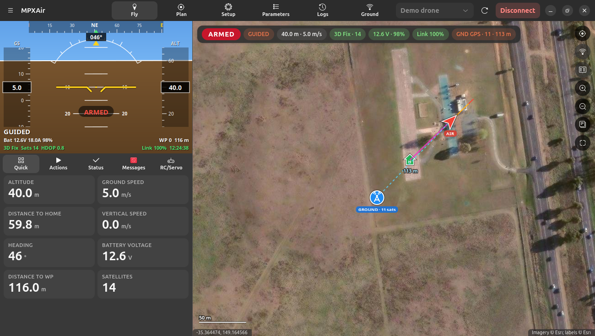
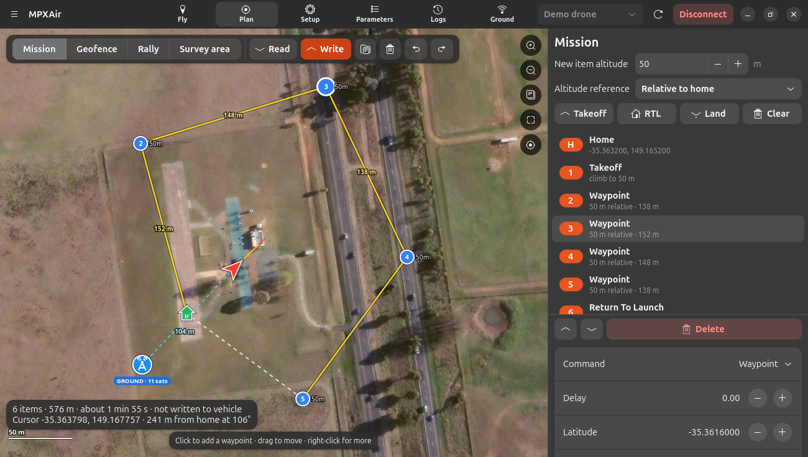
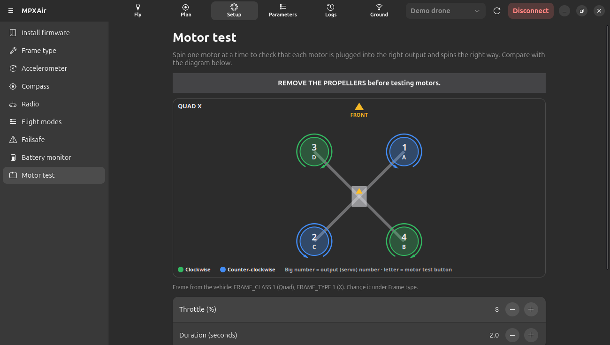
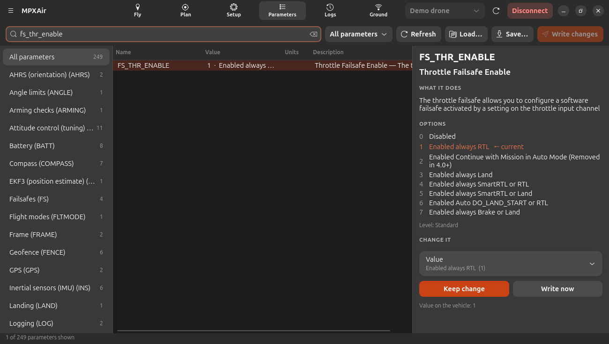
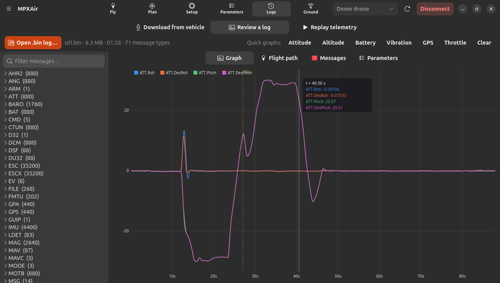
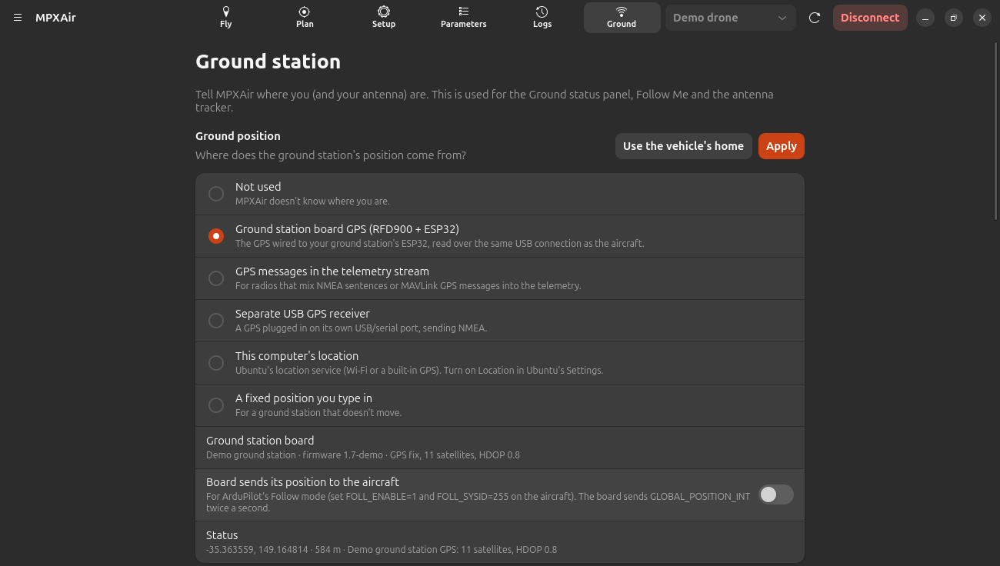

<p align="center">
  
</p>

<h1 align="center">MPXAir</h1>

<p align="center">
  <b>A modern ArduPilot ground control station for Linux</b><br>
  Plan, fly, set up and review drones, planes, rovers and boats, in the spirit of Mission Planner,
  rebuilt natively for Ubuntu.
</p>

<p align="center">
  
  
  
  
  
</p>

<p align="center">
  <a href="https://narl3yyy-svg.github.io/MPXAir/"><b>📖 Read the manual</b></a> ·
  <a href="https://narl3yyy-svg.github.io/MPXAir/install.html">Install</a> ·
  <a href="https://narl3yyy-svg.github.io/MPXAir/quick-start.html">Quick start</a> ·
  <a href="https://narl3yyy-svg.github.io/MPXAir/custom-ground-station.html">Connect your own ground station</a>
</p>

<p align="center">
  
</p>

---

## Contents

- [Why MPXAir](#why-mpxair)
- [Quick start](#quick-start)
- [Installing](#installing)
- [Connecting](#connecting)
- [Features](#features)
- [Ground station hardware](#ground-station-hardware)
- [Screenshots](#screenshots)
- [Testing](#testing)
- [Roadmap](#roadmap)
- [Project layout](#project-layout)
- [Troubleshooting](#troubleshooting)
- [Credits and license](#credits-and-license)

## Why MPXAir

[Mission Planner](https://ardupilot.org/planner/) is the most complete ArduPilot ground station, but it
is a Windows program. MPXAir brings the same workflow to Linux as a native application:

- **Familiar.** The same main screens: Fly, Plan, Setup, Parameters and Logs. It also uses Mission
  Planner's mission files, parameter files, parameter descriptions and command lists.
- **Modern.** A clean GTK 4 / libadwaita interface that matches Ubuntu, with light and dark styles. It
  works on small laptop screens and with touch.
- **Self-contained.** No downloads from outside sources. Everything it needs ships with Ubuntu. The
  MAVLink protocol, map engine, log parser and firmware uploader are all part of MPXAir.

## Quick start

```bash
git clone https://github.com/narl3yyy-svg/MPXAir.git
cd MPXAir
./run.sh
```

There is no hardware yet? Choose **Demo drone (built-in)** at the top right and press **Connect**. A
simulated copter (and a simulated ground station board) lets you try every screen.

| Command | What it does |
|---|---|
| `./run.sh` | Start MPXAir from this folder. Settings go in `~/.config/mpxair`, logs and missions in `~/Documents/MPXAir`. |
| `./run.sh --portable` | Keep settings, map cache and logs inside this folder (`userdata/`). Good for a USB stick. |
| `./run.sh --demo` | Run only the demo drone in the terminal, on `tcp:127.0.0.1:5790`. |

## Installing

```bash
./install.sh
```

The installer:

1. checks for the few Ubuntu packages MPXAir uses (`python3-gi python3-cairo gir1.2-gtk-4.0 gir1.2-adw-1`), and offers to install any that are missing;
2. copies MPXAir to `~/.local/share/mpxair`;
3. adds an **MPXAir** launcher to the app grid and an `mpxair` command;
4. offers to add you to the `dialout` group, which is needed for USB flight controllers and radios.

| Command | What it does |
|---|---|
| `./install.sh --system` | Install for every user (`/opt/mpxair`). Asks for your password. |
| `./uninstall.sh` (or `./uninstall.sh --system`) | Remove MPXAir. Your settings, maps and logs are kept. |

## Connecting

Pick a connection at the top right, then press **Connect**. A progress window shows each step, as in
Mission Planner: link opened, heartbeat received from the aircraft, parameters counting up (for example
*Parameters 812 / 1431*), then the mission, geofence and rally points. It closes on its own once
everything is loaded, so you know the air unit is really talking to you.

| Connection | Use it for |
|---|---|
| USB / serial port (`ttyACM0 · …`, `ttyUSB0 · …`) | Flight controllers over USB (115200) and telemetry radios (usually 57600) |
| UDP (listen) | Port 14550: Wi-Fi telemetry, companion computers |
| TCP | For example `127.0.0.1:5760`, the ArduPilot simulator |
| UDP (send to) | Sending to a fixed address |
| Demo drone (built-in) | A simulated copter for trying things out |

New USB devices are noticed as soon as they're plugged in. Every session is recorded to a telemetry log
(`.tlog`) that you can replay later.

## Features

### Fly
- **HUD**: artificial horizon, pitch ladder, roll, heading tape, speed and altitude tapes, climb rate,
  mode, battery, GPS, link and warnings.
- **Live map**: satellite, street or topographic maps, with the flight trail, home, mission, geofence
  and rally points.
- **Air and ground on one map.** The aircraft is the red **AIR** arrow. The ground station is the blue
  **GROUND** antenna badge, using its own GPS. A dashed line joins them, labelled with the distance.
  - **Keep both in view** frames the aircraft and the ground station together.
  - The **GND GPS** chip shows the ground GPS's satellites and its distance to the aircraft.
- **Map right-click**: Fly to here, Point camera here, Set home here, measure distance, copy coordinates.
- **Actions**:
  - arm and disarm (with force when needed), takeoff, mode buttons, any flight mode;
  - set the current waypoint, start or restart the mission, change speed and altitude;
  - calibrate the gyro or barometer, reboot, trigger the camera.
- **Quick view**: 2 to 16 tiles. Add a tile with **Add a tile**. Click a tile to choose from 45
  values in sections (height, speed and attitude, navigation, battery, GPS and health, telemetry link,
  ground station), or to remove it.
- **GPS status cards**, like Mission Planner: the aircraft's GPS at the bottom-left of the map, the ground
  station's GPS at the bottom-right.
- **Flight trail** that keeps only the last 10 s, 20 s (default), 30 s, 1, 2 or 5 minutes, or the whole
  flight. Older track fades and is cleared automatically. Set it on the Actions tab or in Preferences.
  **Clear Track** still clears it at once.
- **Status, Air and Ground**:
  - **Air**: battery, GPS, EKF, vibration, link and radio quality, home, flight time, wind and firmware.
  - **Ground**: your position, the aircraft's distance, bearing and elevation from you, laptop battery,
    internet and map status, telemetry recording and data rates.
- **Messages** from the autopilot, colour-coded, plus live **RC input and servo output** bars.

### Plan
- Click to add waypoints and drag to move them. Right-click to add spline waypoints, loiters, a land,
  an ROI, or to move the planned home.
- **Takeoff**, **RTL** and **Land** buttons. A clean editor for each item, with the right parameter
  names for each command, and an altitude reference per item (relative, above sea level, terrain).
- Click selects one item, **Ctrl** adds or removes items, **Shift** selects a range. Change the
  altitude of many items at once, reorder, delete. **Undo and redo.**
- **Geofence**: inclusion and exclusion polygons and circles, a return point, plus fence on/off,
  maximum altitude and breach action.
- **Rally points.**
- **Survey grid**: outline an area and MPXAir generates back-and-forth lines. You choose the spacing,
  direction, altitude and turn margin.
- **Clear**: the mission, geofence, rally points, survey area, or everything. You choose whether to
  clear only the plan or the vehicle's copy too.
- Leg distances, total distance and estimated flight time.
- Read from and write to the vehicle. A progress window shows each part (mission, geofence, rally
  points) item by item, and confirms what the aircraft accepted.
- Load and save `.waypoints` files (Mission Planner / QGC WPL 110).

### Setup
- **Install firmware.** MPXAir detects the board in its bootloader and finds the matching build in
  ArduPilot's official firmware list (Stable, Beta or Latest), or uses your own `.apj` file. It then
  erases, writes, verifies and reboots the board.
- **Frame type**, with a motor layout diagram.
- **Accelerometer** calibration: the full six-position version, level only, and simple.
- **Compass** calibration, with live progress for each compass and the results.
- **Radio** calibration.
- **Flight modes**, with the current switch position highlighted live.
- **Failsafes**, **Battery monitor** (including voltage calibration from a multimeter reading).
- **Motor test**: a diagram of your actual frame from ArduPilot's motor layout data. It shows each
  motor's position, output number, test letter and spin direction, and the motor being tested lights up.

### Parameters
- Every parameter, with fast search, filters and full descriptions.
- **Groups sidebar** with friendly names, such as *Battery (BATT)*, *Failsafes (FS)*, *Servo / motor
  outputs (SERVO)* and *EKF3 (EK3)*, so you can browse without knowing the exact name.
- Hover over any parameter, anywhere in MPXAir, to see a short description of what it does.
- Dropdowns for named values, switches for bitmasks, and range-checked numbers.
- Changes are reviewed, then written together. MPXAir offers a reboot when needed.
- Save and load `.param` files (Mission Planner, MAVProxy and QGC formats). Loading compares the file
  with the vehicle first.
- Descriptions come bundled. One click downloads ArduPilot's latest descriptions for newer firmware.

### Logs
- List, download (with automatic gap filling) and erase the logs stored on the vehicle.
- Review `.bin` logs: graph any value with zoom, pan, hover readouts and flight-mode markers; quick
  graphs; the flight path on the map; the log's messages and parameters.
- **Replay** `.tlog` recordings on the Fly screen, with play and pause, a seek bar and speeds from
  0.5× to 25×.

### Ground
Where the ground station's position comes from:

- the **ground station board's own GPS** (RFD900 + ESP32, see below);
- GPS messages mixed into the telemetry stream;
- a separate USB GPS (NMEA);
- this computer's location service;
- a fixed position you type in.

The Ground screen also has:

- **Follow Me**: the aircraft follows the ground station in GUIDED mode.
- **Antenna tracker**: Pololu Maestro, or serial pan/tilt boards.

### Maps
- Six map sources:
  - Esri satellite, satellite with labels, street, topographic;
  - OpenStreetMap;
  - OpenTopoMap.
- Every tile you view is cached. **Offline Maps** downloads whole areas ahead of time, and **Refresh**
  updates saved areas when you're back online.
- Internet use is set to *Online*, *Saver* or *Offline*.

## Ground station hardware

MPXAir reads the GPS of a ground station that shares the telemetry link with the aircraft. Choose its type on the
**Ground** tab. Each type has its own editable settings, plus a **Test now** button and the last message received.

| Type | How the GPS arrives |
|---|---|
| RFD900 + ESP32 board | polled with `#GCS status`; a JSON reply |
| GPS mixed into the telemetry | NMEA sentences or MAVLink GPS already on the link |
| MAVLink GPS from the ground station | `GPS_RAW_INT` / `GLOBAL_POSITION_INT` / `GPS_INPUT` from a ground system ID (255 by default) |
| Custom board, JSON replies | any poll command and reply prefix, with configurable JSON field paths and scaling |
| Custom board, comma-separated replies | lines such as `$GND,lat,lon,alt,sats,fix`, with configurable columns |

Building your own? See **[Connect your own ground station](https://narl3yyy-svg.github.io/MPXAir/custom-ground-station.html)**, which has example firmware.

### RFD900 + ESP32

MPXAir works directly with an **RFD900 + ESP32-S3 ground station board**. On these boards:

- the ESP32 routes the RFD900 telemetry to USB;
- an ELRS receiver can feed RC to the aircraft;
- a GPS module is wired to the ESP32 (UART on GPIO7/6, PPS on GPIO8).

What MPXAir does with the board:

- Connect to the board's USB port (`ttyACM0 · Espressif`) like any telemetry radio. MPXAir recognises
  the ESP32 (USB ID `303a`), releases DTR/RTS so the ESP32 isn't reset, and reads the board's status
  with its `#GCS status` command over the same connection as the telemetry.
- The board's GPS becomes the **ground position**. It is chosen automatically the first time the board
  answers. It appears on the map as the GROUND badge and drives the distance, bearing and elevation
  readouts, Follow Me and the antenna tracker.
- The link stays open even when the aircraft is switched off ("Waiting for aircraft"). When the aircraft
  comes up, its parameters and missions load as usual.
- **Board sends its position to the aircraft** (Ground → Ground position) switches on the board's
  own `GLOBAL_POSITION_INT` broadcast, for ArduPilot's Follow mode. On the aircraft, set `FOLL_ENABLE=1`
  and `FOLL_SYSID=255`.

## Screenshots

| | |
|---|---|
| <br>**Plan**: mission editing with leg distances | <br>**Motor test**: frame diagram with spin directions |
| <br>**Parameters**: search, descriptions, safe editing | <br>**Logs**: graph any value from a `.bin` log |
| <br>**Ground**: where the ground position comes from | <br>**Fly**: AIR and GROUND on one map |

## Testing

These were tested against the real **ArduPilot copter simulator (SITL)**:

- connecting and downloading all 1431 parameters;
- changing parameters;
- arm, takeoff, guided goto, RTL and automatic landing;
- writing a mission and flying it in AUTO;
- uploading and reading back the geofence and rally points;
- downloading and graphing the onboard log;
- replaying telemetry.

The calibration flows and the ground-station board protocol were tested with the built-in demo
drone, which also simulates the board.

**Firmware flashing** was tested against a simulated bootloader, with a byte-for-byte verified
1.6 MB image. Test it on a board you can recover before relying on it.

To fly the simulator yourself, build ArduPilot SITL ([guide](https://ardupilot.org/dev/docs/building-setup-linux.html)),
then:

```bash
cd ardupilot && ./build/sitl/bin/arducopter --model quad --home -35.363261,149.165230,584,353 --defaults Tools/autotest/default_params/copter.parm -I0
```

In MPXAir, choose **TCP**, enter `127.0.0.1:5760` and press **Connect**.

## Roadmap

These Mission Planner features are not in MPXAir yet:

- [ ] Joystick or gamepad control, video feed, scripting, speech
- [ ] Multiple vehicles at once, MAVLink signing, MAVFTP
- [ ] Terrain (SRTM) profile for missions; KML/KMZ and QGC `.plan` files
- [ ] ESC, compass-motor, servo output, OSD, CAN/DroneCAN and SiK radio setup screens. These settings can still be changed on the Parameters tab.
- [ ] Automatic log analysis
- [ ] PX4 firmware (MPXAir is for ArduPilot)
- [ ] Plane, rover and sub flown in the simulator (they are supported but so far only tested with parameters and modes)

## Project layout

```
MPXAir/
├── run.sh, install.sh, uninstall.sh
├── mpxair/
│   ├── app.py            application and main window
│   ├── core/             vehicle link, parameters, missions, logs, firmware, ground station
│   ├── mavlink/          MAVLink definitions (from Mission Planner) and the encoder/decoder
│   ├── maps/             tile providers, cache, offline downloads
│   ├── ui/               screens: fly, plan, setup, params, logs, ground, map, HUD
│   ├── sim/              demo drone and simulated ground-station board
│   └── data/             parameter docs, command lists, motor layouts, icon
├── website/              documentation site (pages + assets), published to GitHub Pages
├── tools/gen_mavlink.py  rebuilds mpxair/mavlink/defs.py from the XML definitions
├── tools/build_site.py   builds the documentation into website/_site
├── tools/publish_site.sh publishes the documentation to the gh-pages branch
└── docs/screenshots/
```

| Where | What |
|---|---|
| `~/.config/mpxair/settings.json` | Settings |
| `~/.cache/mpxair/tiles/` | Cached map tiles (used offline) |
| `~/Documents/MPXAir/telemetry-logs/` | `.tlog` recordings |
| `~/Documents/MPXAir/flight-logs/` | Downloaded `.bin` logs |

## Troubleshooting

- **"Permission denied" on a USB port.** Run `sudo usermod -aG dialout $USER`, then log out and back in. (`install.sh` offers to do this.)
- **A flight controller connects and then drops.** Ubuntu's ModemManager may be probing it. Stop it with `sudo systemctl disable --now ModemManager`.
- **A device vanishes from `lsusb`, and `journalctl -k` shows `error -71` or `device not accepting address`.** This is electrical. Try another short data cable and another USB port. A radio transmitting at high power may need external power or a powered USB hub. Restarting the computer resets a stuck USB port.
- **No map.** Check that Preferences → Maps → *Internet use* isn't set to Offline. Areas you downloaded earlier always work offline.

## Credits and license

MPXAir is developed by **[narl3yyy-svg](https://github.com/narl3yyy-svg)**.

It is inspired by [Mission Planner](https://github.com/ArduPilot/MissionPlanner) by Michael Oborne and
the ArduPilot team. MPXAir includes Mission Planner's parameter documentation, mission command lists
and motor layouts, and the [MAVLink](https://mavlink.io) message definitions.

Map data © Esri and contributors, © OpenStreetMap contributors, © OpenTopoMap (CC-BY-SA).

Licensed under the **GNU General Public License v3.0**, the same as Mission Planner. See
[LICENSE](LICENSE).
